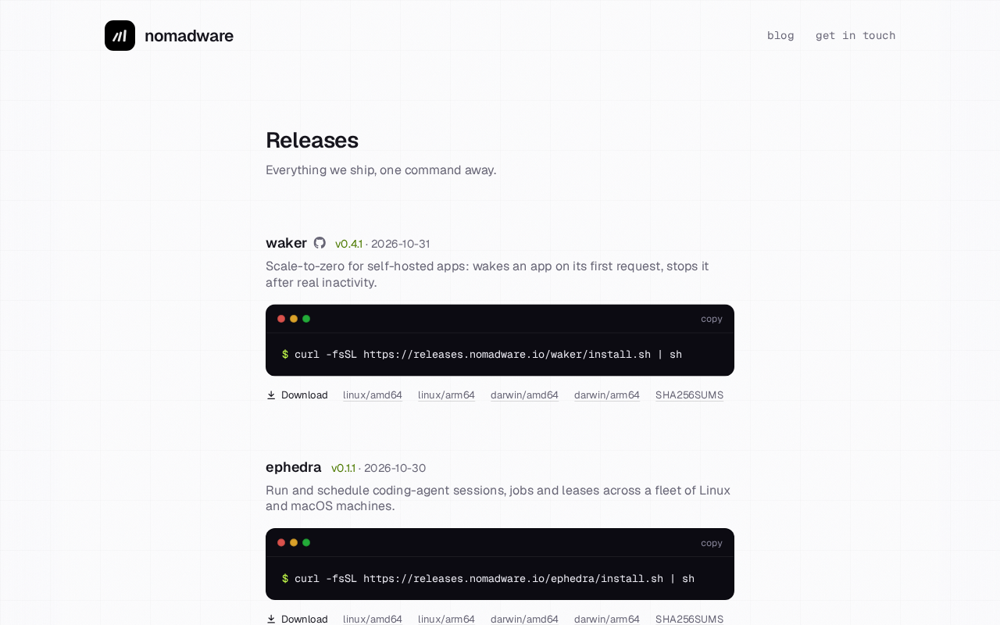
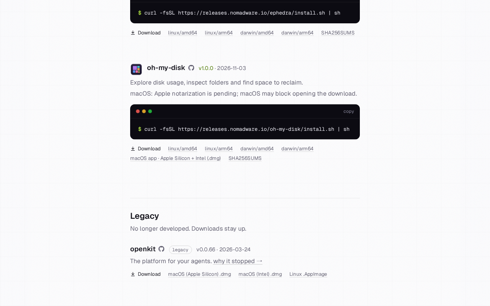
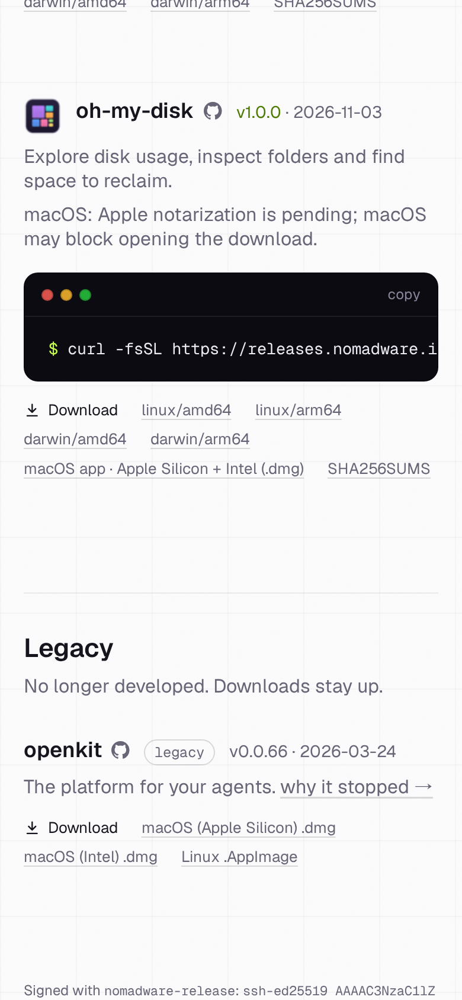

# Desktop release catalogue review

2026-11-03: before is the live catalogue; after is a browser-rendered fixture
of the new oh-my-disk card, with v1.0.0 fixture metadata. It is not evidence
that the application or release has deployed. Card markup, copy and links
match the renderer; the Prism PNG is embedded only for this preview because
the unpublished asset is not yet on the production origin.

| Before | After fixture |
| --- | --- |
|  |  |

Desktop and mobile inspection confirm all five download links, the checksum
link, the unchanged Prism icon and the pending-notarization warning. Neither
viewport has horizontal page overflow. Download verification must follow the
first production publish; this preview does not exercise those URLs.
