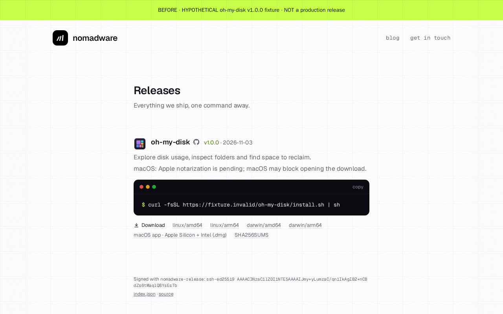
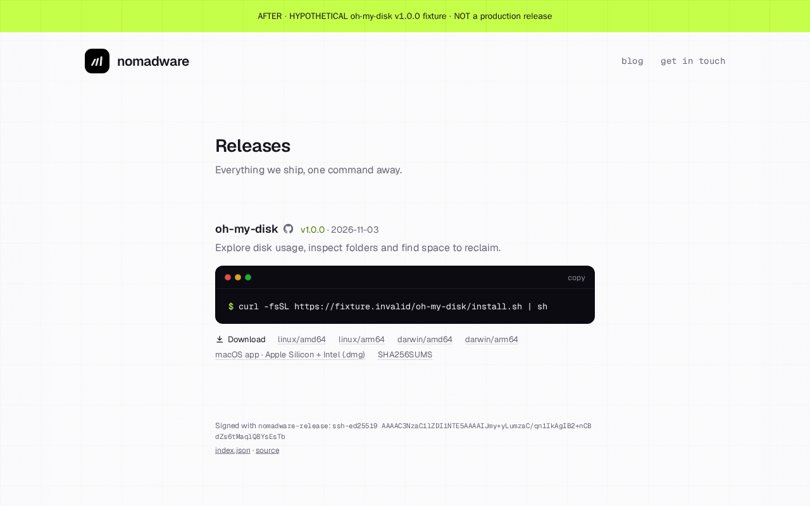
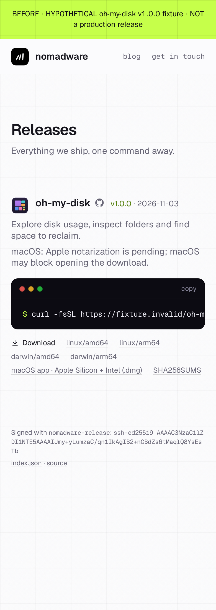
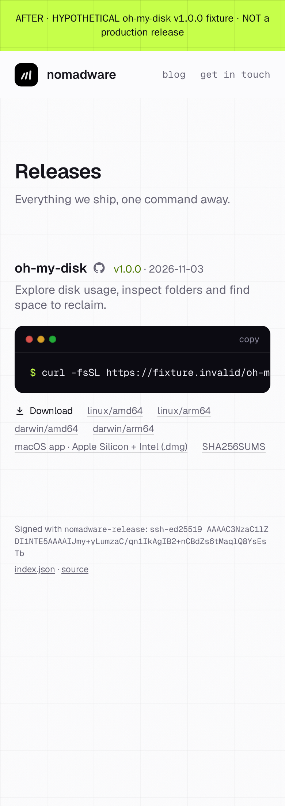

# Desktop release catalogue review

2026-11-03: remove package icons and the notarization warning from catalogue
cards. Both sides below are browser-rendered, explicitly labelled **hypothetical
oh-my-disk v1.0.0 fixtures**, not production releases or deployment evidence.
Before uses the renderer and template at b44360b; after uses the updated files.
Both use the same fixture metadata: 2026-11-03, four CLI assets and one universal
DMG, placeholder checksums, and non-production `https://fixture.invalid` URLs.
The original catalogue public verification key remains displayed.

| Before fixture | After fixture |
| --- | --- |
|  |  |
|  |  |

Desktop (1280 CSS pixels) and mobile (390 CSS pixels) inspection confirms no
package image or notarization notice, all five download links, SHA256SUMS, the
CLI installer, and unchanged Darwin labels. Neither viewport has horizontal
page overflow. Before and after `index.json` are byte-identical, including
signature URLs and asset kinds. Only local fixture assets were requested;
download verification still requires a real release and is not claimed here.

The earlier [live catalogue capture](before.png), [initial desktop
fixture](after-desktop-fixture.png), and [initial mobile
fixture](after-mobile-fixture.png) remain historical evidence of the original
desktop-package addition, not the current presentation.
